```
██████╗      ██╗ █████╗ ███╗   ██╗ ██████╗  ██████╗      █████╗ ██████╗ ██╗
██╔══██╗     ██║██╔══██╗████╗  ██║██╔════╝ ██╔═══██╗    ██╔══██╗██╔══██╗██║
██║  ██║     ██║███████║██╔██╗ ██║██║  ███╗██║   ██║    ███████║██████╔╝██║
██║  ██║██   ██║██╔══██║██║╚██╗██║██║   ██║██║   ██║    ██╔══██║██╔═══╝ ██║
██████╔╝╚█████╔╝██║  ██║██║ ╚████║╚██████╔╝╚██████╔╝    ██║  ██║██║     ██║
╚═════╝  ╚════╝ ╚═╝  ╚═╝╚═╝  ╚═══╝ ╚═════╝  ╚═════╝     ╚═╝  ╚═╝╚═╝     ╚═╝
 █████╗ ██████╗  ██████╗██╗  ██╗██╗████████╗███████╗ ██████╗████████╗
██╔══██╗██╔══██╗██╔════╝██║  ██║██║╚══██╔══╝██╔════╝██╔════╝╚══██╔══╝
███████║██████╔╝██║     ███████║██║   ██║   █████╗  ██║        ██║
██╔══██║██╔══██╗██║     ██╔══██║██║   ██║   ██╔══╝  ██║        ██║
██║  ██║██║  ██║╚██████╗██║  ██║██║   ██║   ███████╗╚██████╗   ██║
╚═╝  ╚═╝╚═╝  ╚═╝ ╚═════╝╚═╝  ╚═╝╚═╝   ╚═╝   ╚══════╝ ╚═════╝   ╚═╝
```

<div align="center">

# ⚡ Django API Architect

**Production-grade Django REST Framework API skills for AI coding agents, built around a service layer architecture.**

[](https://github.com/KinwiseNZ-DevOps/django-api-architect/actions/workflows/validate.yml)
[](LICENSE)
[](https://agentskills.io)
[](https://agentskills.io/specification)
[](scripts/skills_tool.py)

</div>

Table of contents:

- [Skills](#skills)
- [How they fit together](#how-they-fit-together)
- [Optional Django admin theme](#optional-django-admin-theme)
- [Install](#install)
- [Usage](#usage)
- [Host agent profiles](#host-agent-profiles)
- [Validate](#validate)
- [Layout](#layout)
- [Credits](#credits)
- [Status and limits](#status-and-limits)

---

> [!IMPORTANT]
> **Principle: business logic lives in services and selectors; APIs, serializers and models stay thin interfaces over it.**

Nine skills that let a coding agent build, review and extend Django REST API projects with confidence: app packs and project structure, thin DRF APIs with a stable error contract, a service and selector layer, pytest conventions, JWT and OTP authentication, Celery task wiring, and Docker images plus a local Compose stack. They follow the open [Agent Skills](https://agentskills.io/specification) format and work in Claude Code, Codex, Cursor, Copilot, OpenCode, or any SKILL.md-compatible agent. They are grounded in a production Django API starter (team-written) and the public [Django Styleguide](https://github.com/HackSoftware/Django-Styleguide) (credited as supporting theory).

Install supplied Claude Code, GitHub Copilot or Codex agent profiles into a project with `python scripts/install_agents.py --host claude-code --target PATH`. Other compatible hosts receive the skills only. The installer adds profiles to existing host agent folders and preserves unrelated files.

---

<a id="skills"></a>
## 🧩 Skills

<!-- catalogue:begin -->
| Skill | Purpose |
|---|---|
| [`django-api-architect`](skills/django-api-architect/SKILL.md) | Router and shared guardrails for Django REST Framework API projects built on a service layer architecture with thin APIs, services, selectors and app packs. |
| [`django-apis-serializers`](skills/django-apis-serializers/SKILL.md) | Governs DRF API classes, input and output serializers, filtering, pagination, and the JSON error contract. |
| [`django-auth`](skills/django-auth/SKILL.md) | Governs authentication in Django API projects: JWT login, refresh and logout, passwordless OTP codes, admin second factor, and login throttling. |
| [`django-aws-deployment`](skills/django-aws-deployment/SKILL.md) | Governs deploying a Django API to AWS: choosing between ECS on Fargate, App Runner and Elastic Beanstalk, the Django settings every platform needs (ALLOWED_HOSTS, secrets, static files, database, proxy headers), health checks behind a load balancer, where migrations run, and logging. |
| [`django-celery`](skills/django-celery/SKILL.md) | Governs Celery task structure, retries, transaction-safe task triggering, webhook dispatch chains, periodic tasks and Celery configuration. |
| [`django-docker-compose`](skills/django-docker-compose/SKILL.md) | Governs the local Docker Compose stack for Django API projects: web, Postgres, Redis, Celery worker and beat services, health-gated startup, one-off migration, env files and secrets, volumes, ports, hot reload and running tests and management commands in containers. |
| [`django-docker-images`](skills/django-docker-images/SKILL.md) | Governs Dockerfiles and container images for Django API projects: multi-stage builds with dev and runtime targets, a non-root user, dependency and cache layering, .dockerignore, secrets kept out of layers, Gunicorn instead of runserver, health checks and deploy checks. |
| [`django-open-banking`](skills/django-open-banking/SKILL.md) | Governs open banking integrations in Django API projects: initiating account-to-account payments and reading bank account data (balances, transactions) through a provider such as BlinkPay, behind a provider-agnostic interface so a second country or provider can be added without rewriting callers. |
| [`django-project-structure`](skills/django-project-structure/SKILL.md) | Governs Django app layout, the app pack shape, app manifests, and settings organisation for service layer API projects. |
| [`django-services-selectors`](skills/django-services-selectors/SKILL.md) | Governs the service and selector layer: writing business logic, validation placement, transactions, and update helpers. |
| [`django-subscriptions`](skills/django-subscriptions/SKILL.md) | Governs subscription lifecycle management in Django API projects: plans, activation, upgrades and downgrades, cancellation, and payment-failure handling (dunning), behind a provider-agnostic interface for the recurring billing processor (Stripe, PayPal, Apple App Store, Google Play, or similar). |
| [`django-testing`](skills/django-testing/SKILL.md) | Governs the test suite for Django API projects: pytest layout, what to test at each layer, mocking boundaries, and test-state construction. |
<!-- catalogue:end -->

---

<a id="how-they-fit-together"></a>
## 🗺️ How they fit together

```mermaid
flowchart TD
    R["⚡ django-api-architect<br/>routes by layer, enforces shared guardrails"]
    R --> A["🏗️ django-project-structure<br/>app packs, manifests, settings"]
    R --> C["🔌 django-apis-serializers<br/>thin APIs, serializers, error contract"]
    R --> S["⚙️ django-services-selectors<br/>business logic, validation, transactions"]
    R --> T["✅ django-testing<br/>pytest layout, mock boundaries"]
    R --> A2["🔑 django-auth<br/>JWT, OTP, admin second factor"]
    R --> K["📨 django-celery<br/>tasks, retries, webhooks"]
    R --> D1["🐳 django-docker-images<br/>Dockerfile, non-root, production server"]
    R --> D3["☁️ django-aws-deployment<br/>Fargate, App Runner, Elastic Beanstalk"]
    R --> D2["🧱 django-docker-compose<br/>local stack, health-gated startup, env files"]
    R --> OB["🏦 django-open-banking<br/>BlinkPay payments and account data, provider-agnostic"]
    R --> SUB["🔁 django-subscriptions<br/>plans, lifecycle, webhook-driven state, dunning"]
```



Route first with django-api-architect, then work in dependency order: structure, services and selectors, APIs, auth and tasks, tests throughout.

---

<a id="optional-django-admin-theme"></a>
## Optional Django admin theme

For projects that also need a modern Django admin interface, [Unfold](https://unfoldadmin.com/) is an optional theme for dashboards and internal tools. It is separate from the API architecture taught here. Use the [Django REST framework documentation](https://www.django-rest-framework.org/) and [Django 6.1 documentation](https://docs.djangoproject.com/en/6.1/) for framework behaviour. The service-layer approach is a project choice informed by the [Django Styleguide](https://github.com/HackSoftware/Django-Styleguide), not a Django requirement.

---

<a id="install"></a>
## 📦 Install

> [!TIP]
> Install the router skill **plus every sibling skill it links to**; routers reference siblings by relative path.

**Claude Code plugin** (installs the skills and both agent profiles together):

```text
/plugin marketplace add KinwiseNZ-DevOps/django-api-architect
/plugin install django-api-architect@django-api-architect-marketplace
```

**ChatGPT desktop plugin** (local, skills and bundled hooks):

This repo has a portable `plugin.json` manifest and a marketplace at `.agents/plugins/marketplace.json`. Open this repo as a trusted project and restart ChatGPT desktop, then install **Django API Architect** from the Plugins Directory. Review and trust bundled hook scripts before they run.

Or copy or symlink the `skills/` subfolders you want into your agent's skills directory:

| Agent | Where skills live |
|---|---|
| Claude Code | `~/.claude/skills/` or a project's `.claude/skills/` |
| Codex, Cursor, Copilot, OpenCode, Windsurf | the agent's own SKILL.md discovery path |

---

### Always on

In Claude Code, Django API Architect loads a short ruleset into every session as soon as the plugin is installed (thin APIs, logic in services and selectors, environment-driven settings, Docker conventions). It tells you its state at the start of each session and costs roughly 450 tokens.

| Mode | What it does |
|---|---|
| `on` (default) | The rules apply in every session |
| `auto` | The rules apply only in projects that look relevant: a `manage.py` or a Django requirement is found |
| `off` | The rules do not load |

- Say **"stop django mode"** to pause it for the current session, and **"start django mode"** to resume.
- Ask Claude to **set the saved mode to on, off or auto**. It writes that word into `~/.claude/.django-api-architect.mode`. You can also edit that file yourself, and deleting it returns to the default (`on`).
- It needs Node on the machine, because the start-up hook runs a small Node script. Without Node the hook quietly does nothing.
- Other agents have no start-up hook here. Paste `skills/django-api-architect/references/always-on-rules.md` into that agent's instruction file instead.

### Safety checks

The same hooks run a few checks while you work. Each one only asks, warns or adds a reminder; none changes your files on its own.

| Check | What it does | On by default |
|---|---|---|
| `dangerGuard` | Asks before risky commands: force pushes, `git reset --hard`, `rm -r`, dropping data, `docker compose down -v`, publishing a package | Yes |
| `secretsGuard` | Asks before writing keys, tokens or `.env` files | Yes |
| `packageGuard` | Asks if a package about to be installed does not exist on PyPI, npm or pub.dev, because the name may be invented | Yes |
| `licenseGuard` | Warns after installing an npm or PyPI package with a GPL-family licence | Yes |
| `editSecurity` | Reminds Claude about risky code it just wrote: `eval`, SQL built from strings, unescaped HTML, tokens in SharedPreferences | Yes |
| `promptGuard` | Warns when pasted text looks like it is trying to steer the agent | Yes |
| `verifyReminder` | Tells you at the end of a turn if code changed but no tests, lint or analysis ran | Yes |
| `linkGuard` | Warns about links that return "not found" in Markdown, HTML and JSX files written | No |
| `styleGuard` | Warns when a reply is over 200 words or uses an em or en dash (built for AI Kiwiniser's style) | No |
| `sessionLog` | Writes tool names and file names, never content, to `~/.claude/logs/django-api-architect/` | No |
| `autoCommit` | Saves tracked changes as a local commit at the end of a turn. It never pushes | No |

Switch any check with `~/.claude/.django-api-architect.features.json`, for example `{"packageGuard": false, "sessionLog": true}`, or ask Claude to write it. The saved mode (on, off or auto) applies to every check. If several of these plugins are installed, each risky action is checked once, not once per plugin.

Privacy: `packageGuard` and `licenseGuard` send package names, and `linkGuard` sends the links it checks, to the public registry or site. Nothing else leaves your machine. Turn those checks off if that is a concern.

<a id="usage"></a>
## 🚀 Usage

> [!TIP]
> **You never need to memorise skill names.** Just describe the problem in plain words; the router picks the right skill automatically. But if you want short, reliable phrases that always work, use these:

**The flow** (this is all most people need):

```text
1. "Add a billing feature"      → structure skill: new pack, manifest, routes
2. "Write the refund logic"     → services skill: service, validation, transaction
3. "Expose it as an endpoint"   → APIs skill: thin APIView, serializers, schema
```

**Short phrases that trigger each skill:**

| Just say… | What you get | Skill used |
|---|---|---|
| `where does this logic go?` | placement decision, pack shape | *django-project-structure* |
| `write the service / selector` | business logic with validation and transactions | *django-services-selectors* |
| `add an endpoint` | thin API class, serializers, pagination, error contract | *django-apis-serializers* |
| `login / OTP / token` | JWT and OTP flows, throttling, admin second factor | *django-auth* |
| `background task / webhook` | Celery task, retries, on_commit triggering | *django-celery* |
| `dockerise this` | Multi-stage Dockerfile, non-root user, Gunicorn runtime | *django-docker-images* |
| `deploy this to AWS` | Platform choice, production settings, health checks | *django-aws-deployment* |
| `set up local docker` | Compose stack with healthy database, broker, worker and beat | *django-docker-compose* |
| `test this` | pytest layout, mock boundaries, failure paths | *django-testing* |

> [!NOTE]
> Skills also trigger on their own when your request matches. In Claude Code you can also invoke one explicitly with `/<skill-name>`, but the plain phrases above are shorter and work across every agent.

---

<a id="host-agent-profiles"></a>
## Host agent profiles

When a skill is invoked, its router uses the [django-api-architect-workflow](.github/agents/django-api-architect-workflow.agent.md) main profile for normal requests, planning, implementation, and review. It can use [django-api-architect-debugger](.github/agents/django-api-architect-debugger.agent.md) as the optional debugging helper. Each host has at most these two profiles. Prefixing names with the skill slug helps avoid clashes when profiles are installed alongside agents from other skills.

Host profiles are provided for [GitHub Copilot](.github/agents/) and [Claude Code](.claude/agents/). Codex role briefs are provided in [resources/agents/codex/](resources/agents/codex/); after `install_agents.py --host codex` they sit in the target project's `agents/codex/`, and Codex reads them when the router skill directs it, and can use native subagent delegation when the runtime provides it. The Codex briefs are prompt templates, not automatically discovered profiles. Other SKILL.md-compatible hosts can follow the router skill directly or use the role briefs as prompt material. Copy the relevant host profiles into the project where you install the skills; installing a skill alone does not install host agent profiles.

---

<a id="validate"></a>
## ✅ Validate

```bash
python scripts/skills_tool.py check
```

Checks: frontmatter, name/folder match, description length and trigger, body under 500 lines, every relative link resolves (including README.md and AGENTS.md), agent profile naming with no more than two profiles per host and exactly one `-workflow` main agent, at least 3 eval cases per skill, catalogue freshness, no project-specific terms from `reference-content/strip-terms.txt`, and no em or en dashes in file names or in any text outside `reference-content/`. After the starter skill is deleted it also rejects leftover placeholders and setup-only paths that are tracked by Git or not ignored. Stdlib only, no dependencies.

---

<a id="layout"></a>
## 🗂️ Layout

<details>
<summary>Repository layout</summary>

```
skills/<name>/SKILL.md       one folder per skill (+ references/ where needed)
.github/agents/*.agent.md    optional GitHub Copilot agents
.claude/agents/*.md          optional Claude Code project agents
resources/agents/            host profile sources (Claude Code, Copilot, Codex)
.claude-plugin/              plugin.json and marketplace.json (Claude Code plugin)
evals/cases.jsonl            3+ behavioural cases per skill
scripts/skills_tool.py       validate, regenerate catalogue (stdlib only)
.github/workflows/           CI runs `skills_tool.py check` (free on public repos)
AGENTS.md                    agent-facing rules for this repo
```

</details>

---

<a id="credits"></a>
## 🙏 Credits

Details in the skills are checked against the official documentation, linked from the skill that uses them:

- [Django REST framework](https://www.django-rest-framework.org/): permissions and throttling behaviour.
- [Django documentation](https://docs.djangoproject.com/en/6.1/): transactions and `on_commit`.
- [Django Styleguide](https://github.com/HackSoftware/Django-Styleguide): the service and selector layer theory.

---

<a id="status-and-limits"></a>
## 📌 Status and limits

> [!NOTE]
> - The skills teach a primary architecture from an in-house Django API starter; projects with different structures win where they differ, and the router states that explicitly.
> - Throttle rates, quotas and provider credentials are per project; the skills describe patterns, not values.
> - Licensed under MIT (see [LICENSE](LICENSE)).

---

<div align="center">

**⚡ Built on the [Agent Skills](https://agentskills.io) open format · grounded in an in-house Django API starter and the [Django Styleguide](https://github.com/HackSoftware/Django-Styleguide)**

</div>
